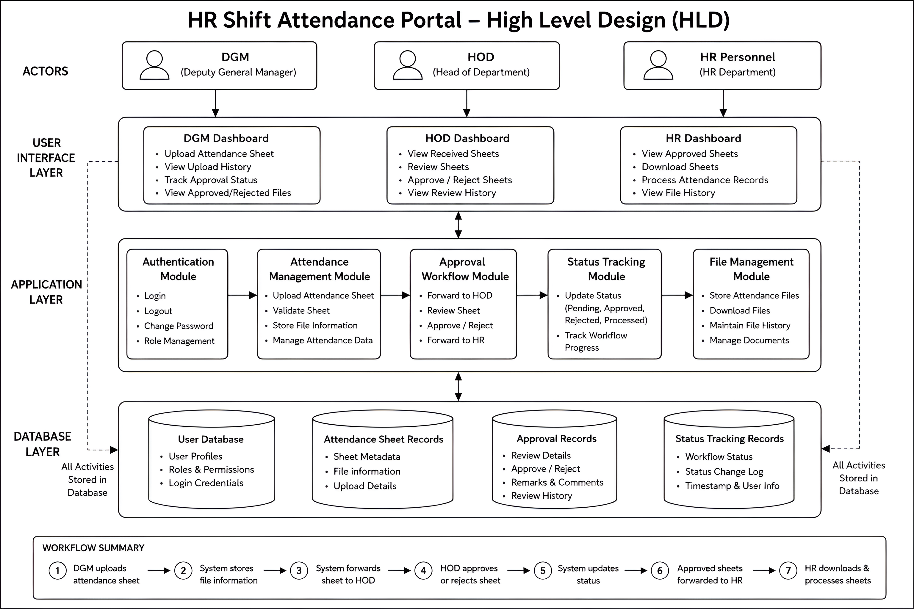
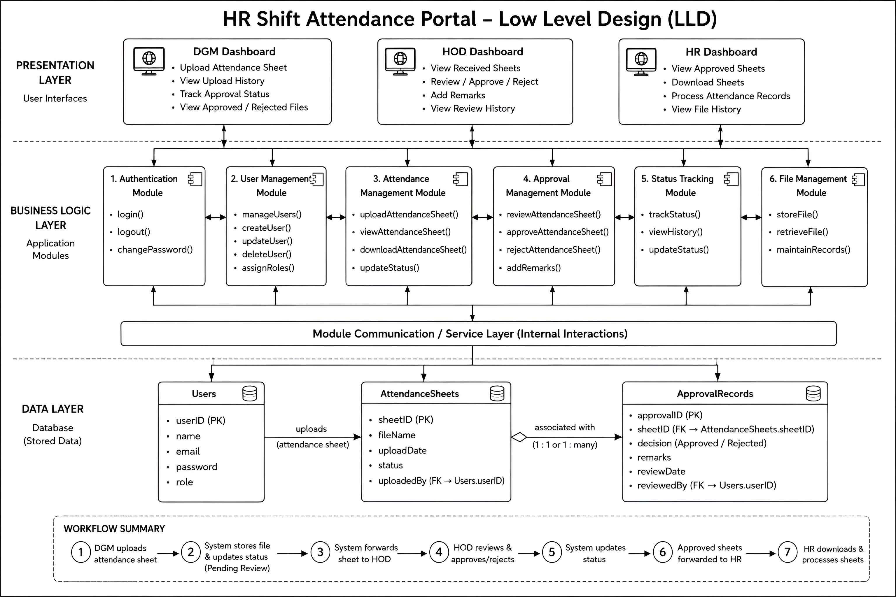
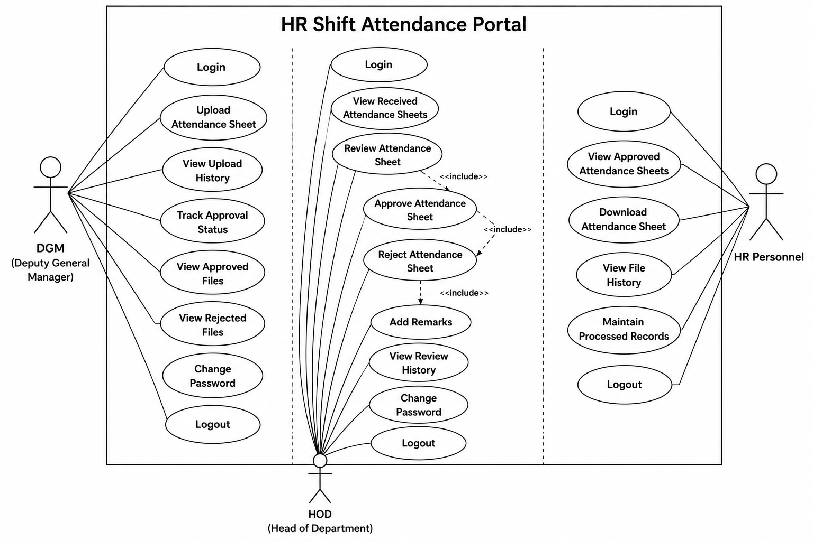
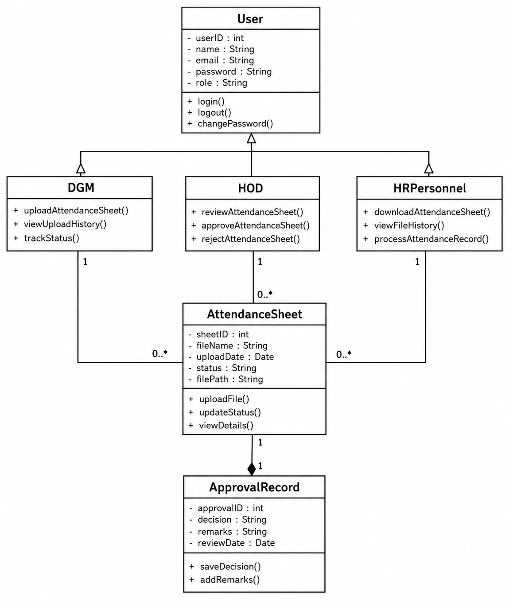
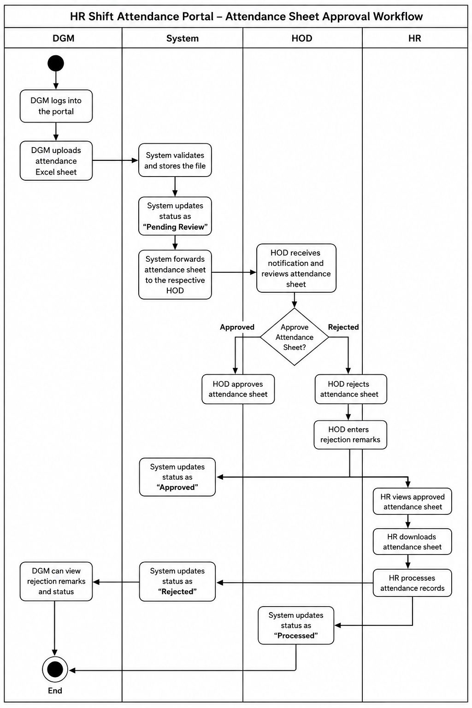
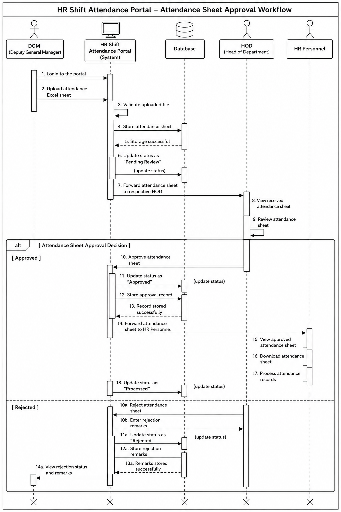
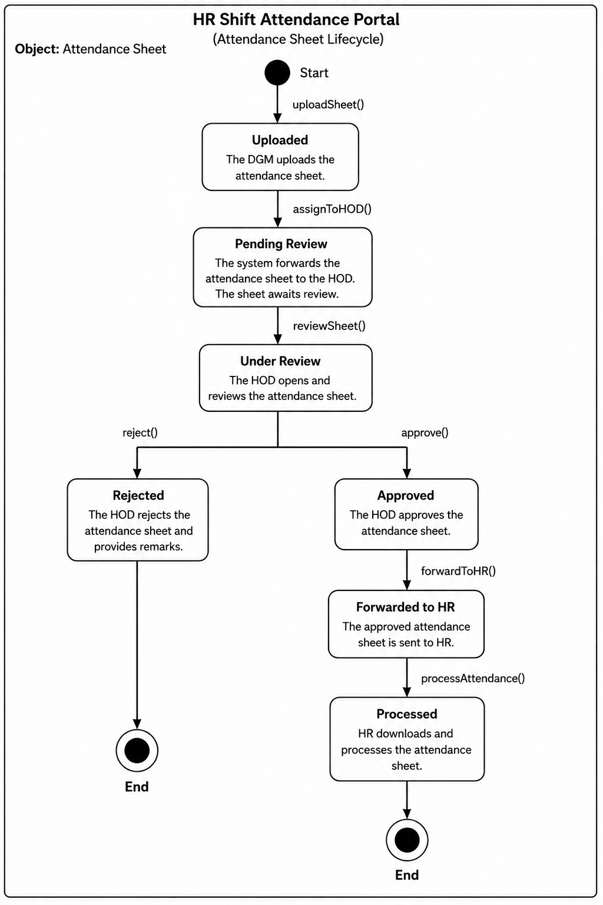

# HR Shift Attendance Portal: System Architecture & Design

This document describes the design of the **HR Shift Attendance Portal** (NTPC Limited) using UML diagrams. The portal digitises the approval of shift attendance sheets: a **DGM** uploads the sheet, the respective **HOD** reviews and approves or rejects it, and **HR Personnel** download and process the approved sheets.

## Table of Contents

1. [Overview](#1-overview)
2. [High Level Design (HLD)](#2-high-level-design-hld)
3. [Low Level Design (LLD)](#3-low-level-design-lld)
4. [Use Case Diagram](#4-use-case-diagram)
5. [Class Diagram](#5-class-diagram)
6. [Activity Diagram](#6-activity-diagram)
7. [Sequence Diagram](#7-sequence-diagram)
8. [State Diagram](#8-state-diagram)

---

## 1. Overview

### Actors

| Actor | Role in the system |
|-------|--------------------|
| **DGM** (Deputy General Manager) | Uploads attendance sheets, tracks their approval status, and views approved and rejected files along with rejection remarks. |
| **HOD** (Head of Department) | Receives and reviews attendance sheets, approves or rejects them, and adds remarks when rejecting. |
| **HR Personnel** | Views approved sheets, downloads and processes them, and maintains processed records. |

### Attendance sheet statuses

| Status | Meaning |
|--------|---------|
| Uploaded | The DGM has uploaded the attendance sheet. |
| Pending Review | The system has stored the file and forwarded it to the HOD; it awaits review. |
| Under Review | The HOD has opened the sheet and is reviewing it. |
| Approved | The HOD has approved the sheet. |
| Rejected | The HOD has rejected the sheet and entered remarks. |
| Forwarded to HR | The approved sheet has been sent to HR. |
| Processed | HR has downloaded and processed the attendance records. |

---

## 2. High Level Design (HLD)

**Description:** The HLD gives a top-down view of the system as four layers. The three actors use role-specific dashboards, which talk to the application modules, which in turn read and write the database. Every activity in the system is stored in the database.

**Layers**

| Layer | Contents |
|-------|----------|
| **Actors** | DGM (Deputy General Manager), HOD (Head of Department), HR Personnel (HR Department) |
| **User Interface Layer** | **DGM Dashboard:** upload attendance sheet, view upload history, track approval status, view approved/rejected files. **HOD Dashboard:** view received sheets, review sheets, approve/reject sheets, view review history. **HR Dashboard:** view approved sheets, download sheets, process attendance records, view file history. |
| **Application Layer** | Five modules, described below. |
| **Database Layer** | Four data stores, described below. |

**Application modules**

| Module | Responsibilities |
|--------|------------------|
| Authentication Module | Login, logout, change password, role management |
| Attendance Management Module | Upload attendance sheet, validate sheet, store file information, manage attendance data |
| Approval Workflow Module | Forward to HOD, review sheet, approve/reject, forward to HR |
| Status Tracking Module | Update status (Pending, Approved, Rejected, Processed) and track workflow progress |
| File Management Module | Store attendance files, download files, maintain file history, manage documents |

**Data stores**

| Database | Contents |
|----------|----------|
| User Database | User profiles, roles and permissions, login credentials |
| Attendance Sheet Records | Sheet metadata, file information, upload details |
| Approval Records | Review details, approve/reject decision, remarks and comments, review history |
| Status Tracking Records | Workflow status, status change log, timestamp and user info |

**Workflow summary:** (1) DGM uploads the attendance sheet, (2) the system stores the file information, (3) the system forwards the sheet to the HOD, (4) the HOD approves or rejects it, (5) the system updates the status, (6) approved sheets are forwarded to HR, (7) HR downloads and processes the sheets.

---

## 3. Low Level Design (LLD)

**Description:** The LLD breaks the HLD down into three layers (presentation, business logic, data) and shows the methods of each module and the database tables with their keys.

**Presentation layer:** the DGM, HOD and HR dashboards, offering the same functions listed in the HLD. All three connect to the business logic layer.

**Business logic layer (application modules)**

| # | Module | Methods |
|---|--------|---------|
| 1 | Authentication Module | `login()`, `logout()`, `changePassword()` |
| 2 | User Management Module | `manageUsers()`, `createUser()`, `updateUser()`, `deleteUser()`, `assignRoles()` |
| 3 | Attendance Management Module | `uploadAttendanceSheet()`, `viewAttendanceSheet()`, `downloadAttendanceSheet()`, `updateStatus()` |
| 4 | Approval Management Module | `reviewAttendanceSheet()`, `approveAttendanceSheet()`, `rejectAttendanceSheet()`, `addRemarks()` |
| 5 | Status Tracking Module | `trackStatus()`, `viewHistory()`, `updateStatus()` |
| 6 | File Management Module | `storeFile()`, `retrieveFile()`, `maintainRecords()` |

The modules communicate with each other and with the database through the **Module Communication / Service Layer** (internal interactions).

**Data layer (tables)**

| Table | Columns |
|-------|---------|
| **Users** | `userID` (PK), `name`, `email`, `password`, `role` |
| **AttendanceSheets** | `sheetID` (PK), `fileName`, `uploadDate`, `status`, `uploadedBy` (FK to `Users.userID`) |
| **ApprovalRecords** | `approvalID` (PK), `sheetID` (FK to `AttendanceSheets.sheetID`), `decision` (Approved / Rejected), `remarks`, `reviewDate`, `reviewedBy` (FK to `Users.userID`) |

**Relationships:** a user uploads attendance sheets (`Users` to `AttendanceSheets`), and each attendance sheet is associated with its approval record(s) (`AttendanceSheets` to `ApprovalRecords`).

**Workflow summary:** (1) DGM uploads the attendance sheet, (2) the system stores the file and updates the status to Pending Review, (3) the system forwards the sheet to the HOD, (4) the HOD reviews and approves or rejects it, (5) the system updates the status, (6) approved sheets are forwarded to HR, (7) HR downloads and processes the sheets.

---

## 4. Use Case Diagram

**Description:** The use case diagram shows what each actor can do inside the HR Shift Attendance Portal.

**DGM**
- Login, Change Password, Logout
- Upload Attendance Sheet
- View Upload History
- Track Approval Status
- View Approved Files
- View Rejected Files

**HOD**
- Login, Change Password, Logout
- View Received Attendance Sheets
- Review Attendance Sheet, which leads to Approve Attendance Sheet or Reject Attendance Sheet
- Add Remarks (required when rejecting a sheet)
- View Review History

**HR Personnel**
- Login, Logout
- View Approved Attendance Sheets
- Download Attendance Sheet
- View File History
- Maintain Processed Records

---

## 5. Class Diagram

**Description:** The class diagram shows the main classes of the system, their attributes and methods, and how they relate.

| Class | Attributes | Key methods |
|-------|-----------|-------------|
| **User** (base class) | userID, name, email, password, role | login(), logout(), changePassword() |
| **DGM** (extends User) | | uploadAttendanceSheet(), viewUploadHistory(), trackStatus() |
| **HOD** (extends User) | | reviewAttendanceSheet(), approveAttendanceSheet(), rejectAttendanceSheet() |
| **HRPersonnel** (extends User) | | downloadAttendanceSheet(), viewFileHistory(), processAttendanceRecord() |
| **AttendanceSheet** | sheetID, fileName, uploadDate, status, filePath | uploadFile(), updateStatus(), viewDetails() |
| **ApprovalRecord** | approvalID, decision, remarks, reviewDate | saveDecision(), addRemarks() |

**Relationships**
- `DGM`, `HOD` and `HRPersonnel` inherit from `User`.
- Each `DGM`, `HOD` and `HRPersonnel` (1) is associated with zero or more `AttendanceSheet` objects (0..*).
- Each `AttendanceSheet` has one `ApprovalRecord` (1 to 1), which stores the HOD's decision and remarks.

---

## 6. Activity Diagram

**Description:** A swimlane diagram of the attendance sheet approval workflow, with lanes for **DGM**, **System**, **HOD** and **HR**.

1. The DGM logs into the portal and uploads the attendance Excel sheet.
2. The system validates and stores the file, sets the status to **Pending Review**, and forwards the sheet to the respective HOD.
3. The HOD receives a notification and reviews the sheet, then decides whether to approve it.
4. **If approved:** the system updates the status to **Approved** and forwards the sheet to HR. HR views the approved sheet, downloads it, and processes the attendance records. The system then updates the status to **Processed**.
5. **If rejected:** the HOD rejects the sheet and enters rejection remarks, and the DGM can view the rejection remarks and status.

---

## 7. Sequence Diagram

**Description:** The sequence diagram shows the order of messages between the **DGM**, the **HR Shift Attendance Portal (System)**, the **Database**, the **HOD** and **HR Personnel**.

**Common flow (steps 1 to 9)**
1. DGM logs in to the portal.
2. DGM uploads the attendance Excel sheet.
3. System validates the uploaded file.
4. System stores the sheet in the database, and the database confirms storage (step 5).
6. System updates the status to "Pending Review".
7. System forwards the sheet to the respective HOD.
8. HOD views the received sheet.
9. HOD reviews the sheet.

**Alternative: Approved (steps 10 to 18)**
- 10. HOD approves the sheet.
- 11. System updates the status to "Approved".
- 12 to 13. System stores the approval record, and the database confirms.
- 14. System forwards the sheet to HR Personnel.
- 15 to 17. HR views, downloads and processes the attendance records.
- 18. System updates the status to "Processed".

**Alternative: Rejected (steps 10a to 14a)**
- 10a to 10b. HOD rejects the sheet and enters rejection remarks.
- 11a. System updates the status to "Rejected".
- 12a to 13a. System stores the remarks, and the database confirms.
- 14a. DGM views the rejection status and remarks.

---

## 8. State Diagram

**Description:** The state diagram shows the lifecycle of an **Attendance Sheet** object, from upload to its final state.

| From state | Event / method | To state |
|-----------|----------------|----------|
| Start | `uploadSheet()` | Uploaded |
| Uploaded | `assignToHOD()` | Pending Review |
| Pending Review | `reviewSheet()` | Under Review |
| Under Review | `reject()` | Rejected (end) |
| Under Review | `approve()` | Approved |
| Approved | `forwardToHR()` | Forwarded to HR |
| Forwarded to HR | `processAttendance()` | Processed (end) |

A sheet ends either as **Rejected** (the HOD provides remarks) or as **Processed** (HR has downloaded and processed it).
